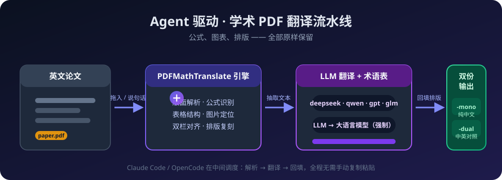
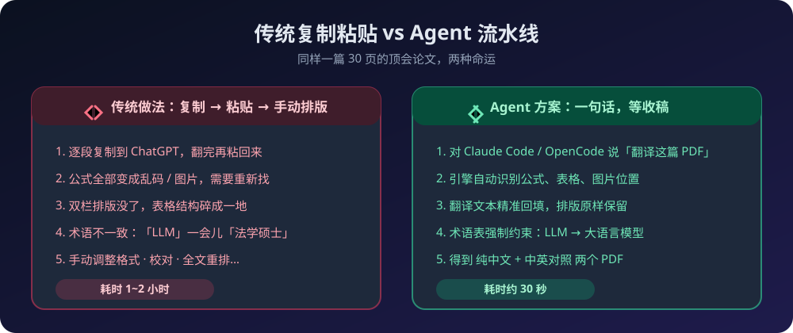
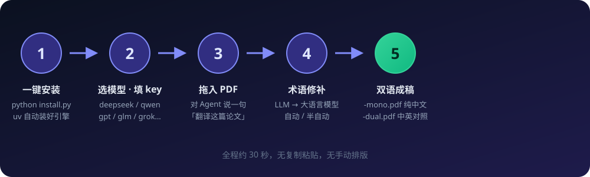
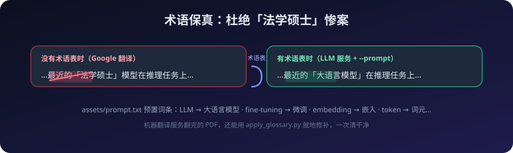

<p align="center">
  
</p>

# cc-pdf2zh-skill · 让 AI 代理帮你翻译整本论文 PDF

> **一句话**：把英文 PDF 丢给 **Claude Code / OpenCode**，说一句「翻译这篇论文」，
> 回来的是**保留公式、图表、排版**的 纯中文 + 中英对照 两个 PDF。

[](https://www.python.org)
[](https://github.com/astral-sh/uv)
[](https://github.com/PDFMathTranslate/PDFMathTranslate)
[](#license)
[](#-安装)


---

## 为什么值得装

读英文文献最痛苦的从来不是「看不懂」，而是「翻译完没法看」：

| | 传统做法（复制粘贴） | 本方案（Agent 流水线） |
|---|---|---|
| 公式 | 变成乱码或图片，重新找 | **原样保留，一个符号都不跑** |
| 双栏排版 / 表格 | 碎成一地，手动拼回 | **结构完整，就地翻译** |
| 图表位置 | 全乱了 | **原位不动** |
| 术语一致性 | 「LLM」一会儿是「法学硕士」 | **术语表强制约束** |
| 你的工作量 | 复制、粘贴、排版、校对 1~2 小时 | **说一句话，30 秒后收稿** |



## 它是什么

本 skill 是 [PDFMathTranslate](https://github.com/PDFMathTranslate/PDFMathTranslate)
（Apache-2.0 开源引擎）的**薄薄一层指挥层**：

- 引擎负责**版面解析 → 文本抽取 → 翻译 → 回填**，保住公式、表格、双栏；
- skill 负责把它们接进 Agent 工作流：装环境、选模型、管 key、灌术语表、一键出稿；
- **Claude Code 和 OpenCode 通用** —— skill 就是一套指令 + 脚本，没有平台绑定。

安装也顺带解决了：**不需要 conda 了**，用 [uv](https://github.com/astral-sh/uv) 一条命令
建好独立虚拟环境并装上官方引擎（原项目就是 pip 包，直接复用，无需打包搬运）。



## 安装（30 秒，交互式向导）

```bash
git clone https://github.com/haorantang1999/cc-pdf2zh-skill.git
cd cc-pdf2zh-skill
python install.py                # 默认装给 Claude Code
# python install.py --agent opencode    # 装给 OpenCode
```

安装向导会做四件事，全程交互、有问必答：

```
1. 用 uv 创建 .venv 并安装官方 pdf2zh 引擎（自动，无需 conda）
2. 把 skill 部署到 Agent 的 skills 目录
3. 让你选择翻译服务 ──────────────┐
   [ 1] DeepSeek（官方）          │ ← 必答的两问：
   [ 2] OpenAI / ChatGPT          │    「用哪家模型？」 + 「API key 是多少？」
   [ 3] 智谱 GLM（免费额度大）    │    key 只写入本地 .env，不进任何代码
   [ 4] 阿里通义 qwen-mt（翻译专用模型，术语最稳）
   [ 5] xAI Grok      [ 6] Google Gemini      [ 7] 硅基流动
   [ 8] 魔搭 ModelScope           [ 9] Groq 极速
   [10] Google 翻译（免费）       [11] 必应翻译（免费）   [12] DeepL
   [13] Argos 离线翻译（免费）    [14] Ollama 本地模型（免费）
   [15] 任意 OpenAI 兼容端点（Kimi / Claude 网关等）
4. （可选）连通性测试，确认 key 能正常使用
```

> 之前用 conda 装过？没关系。`run.sh` 会优先用 `.venv` 里的引擎，
> 找不到再回退到 PATH 上的 `pdf2zh`，老环境无缝过渡。

## 使用

```bash
# 在 skill 目录下（或让 Agent 代劳——这才是日常用法）
./run.sh paper.pdf -o out/          # 一篇
./run.sh --dir papers/              # 一个目录批量
./run.sh -i                         # 图形界面（本地 Web UI）
```

产出：

| 文件 | 内容 |
|---|---|
| `paper-mono.pdf` | **纯中文**版 |
| `paper-dual.pdf` | **中英对照**版 |

**日常用法其实是这样的**：

```
你：帮我把 Nature 这篇 PDF 翻译成中文
Agent：好的，正在调用 pdf2zh 引擎（deepseek 模型 + 术语表约束）…
      ✓ 版面解析完成（42 页，17 个公式，6 张图）
      ✓ 翻译完成，双栏排版已保留
      → out/paper-dual.pdf（中英对照）
      → out/paper-mono.pdf（纯中文）
```

## 支持的翻译服务

LLM 服务都支持 **--prompt 术语约束**（把 `LLM → 大语言模型` 这类词条写死），
机器翻译服务免费但术语不可控，可用[路线 B](#术语保真)修补。

| 服务 | 环境变量 | 默认模型 | 特点 |
|---|---|---|---|
| `deepseek` | `DEEPSEEK_API_KEY` | `deepseek-chat` | 便宜、中文好，推荐默认 |
| `openai` | `OPENAI_API_KEY` | `gpt-4o-mini` | ChatGPT 官方 |
| `zhipu` | `ZHIPU_API_KEY` | `glm-4-flash` | 免费额度大 |
| `qwen-mt` | `ALI_API_KEY` | `qwen-mt-turbo` | 翻译专用模型，术语最稳 |
| `grok` | `GROK_API_KEY` | `grok-2-1212` | xAI |
| `gemini` | `GEMINI_API_KEY` | `gemini-1.5-flash` | Google |
| `silicon` | `SILICON_API_KEY` | `Qwen/Qwen2.5-7B-Instruct` | 国产平替，便宜 |
| `modelscope` | `MODELSCOPE_API_KEY` | `Qwen/Qwen2.5-32B-Instruct` | 魔搭 |
| `groq` | `GROQ_API_KEY` | `llama-3-3-70b-versatile` | 极速 |
| `ollama` | `OLLAMA_HOST` | `gemma2` | 本地模型，0 成本 |
| `openailiked` | `OPENAILIKED_*` | 自定 | 任意 OpenAI 兼容端点 |
| `google` / `bing` / `argos` | 无 | — | 免费机器翻译 |
| `deepl` | `DEEPL_AUTH_KEY` | — | 高质量机翻 |

> **想用 Kimi？** Moonshot 官方就是 OpenAI 兼容 API：选 `openailiked`，
> 填 `https://api.moonshot.cn/v1` + key + 模型名即可。
> **想用 Claude？** Anthropic 官方 API 不是 OpenAI 协议，需要先搭一个
> OpenAI→Anthropic 兼容网关，再把网关地址填进 `openailiked`。

## 术语保真



- **路线 A（推荐，LLM 服务）**：`--prompt` 注入 `assets/prompt.txt` 术语模板，
  LLM 被强制按术语表翻译；
- **路线 B（所有服务通用）**：翻译完的 PDF 还能用 `apply_glossary.py`
  在原文位置盖白块、叠写正确术语，周边排版分毫不动：

```bash
python assets/apply_glossary.py out/paper-mono.pdf \
  -g my-glossary.txt -o out/paper-fixed.pdf
```


## 常见问题

**必须要 conda 吗？** 不需要。uv 一条命令搞定。硬要 conda 也行：
`conda create -n pdf2zh -c conda-forge pdf2zh`。

**国内安装慢 / 报编译错误？** 安装器强制使用预编译 wheel（无需本机 Rust/MSVC）。
网络慢就用清华镜像：`UV_DEFAULT_INDEX=https://pypi.tuna.tsinghua.edu.cn/simple python install.py`。

**免费方案有吗？** 有：`google` / `bing` / `argos` 零成本（质量与术语可控性一般）；
`ollama` 跑本地模型零成本（吃显存）。其他 LLM 服务按 token 计费，一篇论文通常几分钱。

**会改坏我的原 PDF 吗？** 不会。原文件只读，输出是新的 `-mono` / `-dual` 文件。

**换模型 / 换 key 麻烦吗？** 改 `.env` 三行，或重跑 `python install.py --skip-venv --skip-copy` 走配置向导。

**引擎升级？** `python install.py --skip-copy --skip-config` 重装最新版 pdf2zh。

**OpenCode 怎么装？** `python install.py --agent opencode`。

## License

本仓库（skill 指令、安装器、脚本）采用 **MIT**。
翻译引擎 [PDFMathTranslate](https://github.com/PDFMathTranslate/PDFMathTranslate)
为 Apache-2.0，感谢上游项目的出色工作。
